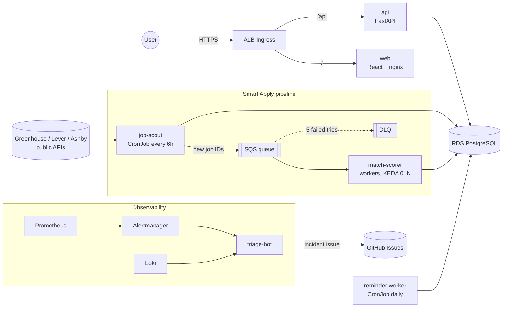

# HireTrack

**A job-search tracker with "Smart Apply", run on an AWS EKS DevSecOps platform.**

Track applications on a Kanban board, see analytics and practise interviews. On a schedule,
HireTrack fetches new openings from public job-board APIs, scores each one against your skills,
and queues the good matches with a ready-made cover note. You approve, and **you** apply on
the company's site. Nothing is ever auto-submitted.

[](.github/workflows/api.yml)
[](.github/workflows/web.yml)
[](.github/workflows/security.yml)

## Architecture



| Service | What it does | Runs as |
|---|---|---|
| `api` | tracker REST API, review queue, practice interviews, analytics, CSV export | Deployment / Argo Rollouts canary, HPA |
| `web` | React 18 + TypeScript SPA | Deployment (nginx, non-root) |
| `job-scout` | reads public board APIs politely (robots.txt, rate limit, retries), dedupes, publishes | CronJob |
| `match-scorer` | scores jobs 0-100 (skills, role, location, "N+ years"), picks a resume variant, writes the kit | queue worker, scales on queue depth |
| `reminder-worker` | follow-up reminders for applications quiet for 7 days | CronJob |
| `triage-bot` | Alertmanager webhook → Prometheus + Loki context → GitHub issue with probable cause | Deployment |

## What it demonstrates

- **Event-driven workers:** a queue abstraction (`QUEUE_BACKEND=redis|sqs`), at-least-once
  delivery made safe by idempotent consumers, a dead-letter queue, a transactional outbox in
  the scout, and graceful shutdown on SIGTERM.
- **Kubernetes done properly:** liveness ≠ readiness, a heartbeat liveness check for workers,
  PDBs, topology spread, read-only root filesystems, no capabilities, a migration Job as a
  pre-upgrade hook, NetworkPolicies, and one ServiceAccount per component (EKS Pod Identity).
- **GitOps + progressive delivery:** Argo CD app-of-apps with sync waves, and an Argo Rollouts
  canary (20% → 50% → 100%) that aborts by itself when the canary's 5xx ratio goes up.
- **SLOs as code:** 99.5% availability and p95 < 300 ms, recording rules, multi-window
  error-budget burn alerts, a runbook per alert, and an alert-to-issue triage bot.
- **DevSecOps CI:** lint, typecheck, unit + integration tests (testcontainers), multi-arch
  images (amd64 + Graviton arm64), Gitleaks, Trivy (dependencies, images, IaC), SBOMs, and
  actions and images pinned by SHA/digest.
- **Chaos-tested:** scripts for pod kill, fault injection, CPU stress, cutting DB egress and
  poison messages, each with the expected outcome written down.

## Tech

Python 3.12 · FastAPI · SQLAlchemy 2 · Alembic · Pydantic v2 · uv workspace · React 18 · TypeScript ·
Vite · TanStack Query · Tailwind · PostgreSQL · Redis Streams / Amazon SQS · Docker · Helm ·
Argo CD · Argo Rollouts · KEDA · External Secrets · Terraform · Prometheus · Grafana · Loki · Alloy · GitHub Actions · AWS (EKS, RDS, SQS, ECR).

## Run it locally

Needs Docker. Copy `.env.example` to `.env`, then set `DB_PASSWORD` and `JWT_SECRET` (32+ characters).

```bash
docker compose up --build            # postgres, redis, migrate, api, web, match-scorer, triage-bot
open http://localhost:8080           # web    (API docs: http://localhost:8000/docs)

docker compose run --rm job-scout    # one scout run (real public board APIs)
uv run python scripts/seed-data.py --with-smart-apply   # demo data + review-queue matches
```

## Deploy to AWS

Terraform builds the AWS side (VPC, EKS on Graviton spot, RDS, SQS + DLQ, ECR, SSM, Pod
Identity roles, GitHub OIDC role); Argo CD deploys everything inside the cluster from Git; the
`release` workflow pushes multi-arch images to ECR and bumps the tag Argo CD deploys.
Step by step, cost (≈ $7/day) and teardown: [infra/terraform/README.md](infra/terraform/README.md).

Development without containers: `make help` lists every target (`make test`, `make lint`,
`make run-api`, `make web-dev`, ...).

## Repository

```
services/           api, web, job-scout, match-scorer, reminder-worker, triage-bot
libs/hiretrack_common/   shared models, queue abstraction, logging, metrics, ops server
config/             sources.yaml (companies to scout), skills.yaml (skill taxonomy)
deploy/helm/        the app chart (+ SLO rules, dashboard)    deploy/README.md: AWS contract
deploy/argocd/      AppProject, app of apps                    deploy/platform/: add-on values
infra/terraform/    AWS: bootstrap (state bucket) + envs/dev
docker/             shared worker Dockerfile
docs/               runbooks/, adr/, design/
scripts/            seed-data.py, chaos/, bootstrap-cluster.sh, teardown.sh
.github/workflows/  api (all Python), web, helm, security, release (ECR push + GitOps tag bump)
```

## Decisions

Short write-ups of the main design choices are in [docs/adr](docs/adr).
