# HireTrack

**A job-search tracker with "Smart Apply", built as a React + Python product and run on an
AWS EKS DevSecOps platform.**

Track every application on a Kanban board, see what is working in analytics, and practise
interviews. In the background, HireTrack fetches new openings from public job-board APIs,
scores each one against your skills, and queues the good matches with a ready-made cover note.
You review, approve, and **you** apply on the company's site. Nothing is ever auto-submitted.

[](.github/workflows/api.yml)
[](.github/workflows/web.yml)
[](.github/workflows/security.yml)
[](.github/workflows/release.yml)

---

## At a glance

| | |
|---|---|
| **Product** | Job tracker + Smart Apply (job discovery and matching) + interview practice |
| **Frontend** | React 18, TypeScript, Vite, TanStack Query, Tailwind, React Hook Form + Zod, dnd-kit, Recharts, Vitest |
| **Backend** | Python 3.12, FastAPI, SQLAlchemy 2, Alembic, Pydantic v2; 6 services (API, web, 3 workers, incident bot) |
| **Cloud** | AWS: EKS (Graviton), RDS PostgreSQL, SQS + DLQ, ECR, SSM, KMS, ALB; all built with Terraform |
| **Delivery** | GitHub Actions → ECR (OIDC, no keys) → Argo CD GitOps → Argo Rollouts canary |
| **Operations** | Prometheus, Grafana, Loki, Alertmanager, SLOs as code, KEDA autoscaling, an alert-to-GitHub-issue triage bot |
| **Quality** | 140+ Python tests (unit + Postgres integration), 65 frontend tests, ruff, mypy, ESLint, Trivy, Gitleaks |
| **Proof** | Deployed end to end on EKS; [screenshots below](#see-it-running) |

---

## What the app does

### 1. Tracker: the everyday job search
- **Dashboard:** pipeline counts, upcoming interviews, and follow-ups that are due.
- **Board:** a Kanban board (Wishlist → Applied → Interview → Offer / Rejected). Drag a card to
  change its status. The API enforces the allowed moves (an illegal move gets `409 Conflict`).
- **Applications:** a searchable, filterable, paginated table, with CSV export.
- **Analytics:** applications per week, the funnel, results by source and by resume variant, and
  average days to the first interview.
- **Reminders:** the `reminder-worker` creates a follow-up for any application with no update in 7 days.

### 2. Smart Apply: find jobs worth applying to (human in the loop)

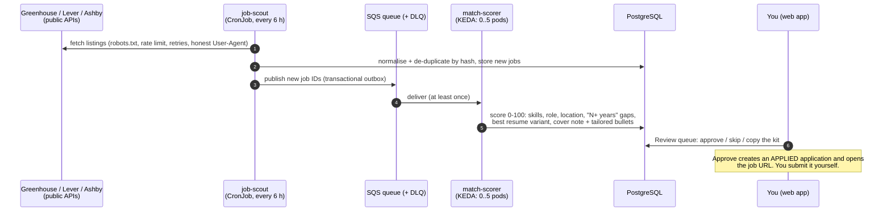

- **Scoring** is explainable: matched skills, missing skills, experience gaps, and why a resume
  variant was suggested.
- **The kit** (cover note + 2-3 resume bullets) is template-based by default. An LLM can be
  switched on with `LLM_PROVIDER=anthropic`.
- **Reliability:** messages are delivered at least once, so consumers are idempotent. A message
  that fails 5 times goes to a dead-letter queue instead of blocking the queue.
- **Never:** auto-submitting, browser automation, scraping sites that forbid it, or storing
  job-portal passwords. ([ADR 0002](docs/adr/0002-human-in-the-loop-smart-apply.md))

### 3. Practice interview
Pick a role and topics. The interviewer asks questions from a question bank, scores each
answer 0-10 against the key points a strong answer covers, and gives feedback. Rule-based by
default, with an optional LLM interviewer.

### 4. triage-bot: the on-call assistant

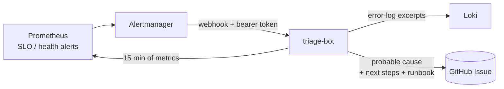

When an alert fires, the bot collects 15 minutes of context (affected pods, metric snapshot,
error logs), works out a **probable cause** with ordered rules (database, out-of-memory,
crash loop, queue, scout, latency, error rate, chaos experiment), and opens a GitHub issue that
links the alert's runbook. `LLM_PROVIDER=anthropic` swaps the rules for an LLM analysis.

---

## Frontend

The web app is a React 18 + TypeScript single-page app: a SaaS-style dashboard with a dark
sidebar, top-bar search, an "Add application" flow, toasts for every API result, and a
light/dark theme.

| Screen | What is in it |
|---|---|
| Login | React Hook Form + Zod validation, JWT session, expired token → back to login |
| Dashboard | KPI cards, pipeline, upcoming interviews, follow-ups |
| Board | Kanban drag and drop (dnd-kit) with **optimistic updates** |
| Review queue | Smart Apply matches: score, matched skills, gaps, kit to copy, approve / skip |
| Applications | Search (debounced), status filters, pagination, CSV download |
| Analytics | Recharts: weekly bars, funnel, by source, by resume variant |
| Practice interview | Chat-style session, per-answer score and feedback, session history |
| Match profile | Skills with weights, target roles, locations, years of experience |

**How it is built:**
- **Server state with TanStack Query:** typed query keys, cache invalidation after mutations.
  Dragging a card updates the board **before** the API answers, and rolls back if the API
  says no (for example a `409` for an illegal status move).
- **Logic separated from views:** each feature has a `useXController` hook (data, state, actions)
  and plain presentational components, which keeps components small and easy to test.
- **Forms:** React Hook Form with Zod schemas, so the same schema gives validation and the TypeScript types.
- **One HTTP client** (`lib/api/client.ts`): auth header, typed `ApiError`, and a global 401 handler.
- **Performance:** every page is **lazy-loaded**, so heavy libraries (charts, drag and drop)
  load only on the pages that use them.
- **One image for every environment:** the API URL is read at runtime from `/config.json`,
  written when the container starts, not baked into the bundle. Behind the load balancer it is
  empty, meaning "same origin".
- **Production container:** multi-stage build, served by **nginx as non-root** with a
  read-only root filesystem, long-term caching for hashed assets and an SPA fallback.
- **Quality:** strict TypeScript, ESLint, Prettier, and 65 Vitest + Testing Library tests
  (forms, board logic, controllers, API client, config).

Code: [`services/web/src`](services/web/src) (`app/` routing and providers, `features/` one
folder per screen, `components/` shared UI, `lib/` API client and utilities).

---

## Architecture

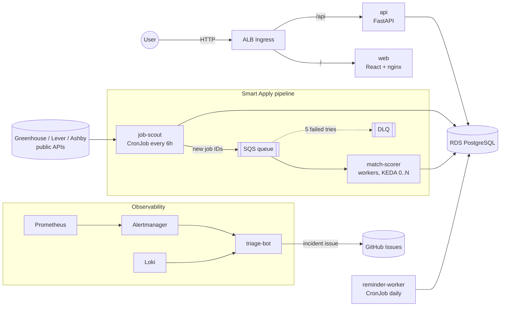

| Service | What it does | Runs as |
|---|---|---|
| `api` | tracker REST API, review queue, practice interviews, analytics, CSV export | Argo Rollouts canary + HPA |
| `web` | React 18 + TypeScript SPA | Deployment (nginx, non-root) |
| `job-scout` | reads public board APIs politely, de-duplicates, publishes | CronJob |
| `match-scorer` | scores jobs, picks a resume variant, writes the kit | queue worker, KEDA scales 0..5 on SQS depth |
| `reminder-worker` | follow-up reminders for quiet applications | CronJob |
| `triage-bot` | Alertmanager webhook → Prometheus + Loki context → GitHub issue | Deployment |

**Every Python service has the same layers:** `controllers/` (HTTP only) → `services/` (business
rules) → `repositories/` (DB access) → `models/` / `schemas/`, with `core/` for config, logging
and security. Every setting comes from env vars, logs are JSON on stdout, each service has
`/healthz`, `/readyz` and `/metrics`, and SIGTERM triggers a graceful shutdown.

---

## Platform and DevOps

### From a commit to production

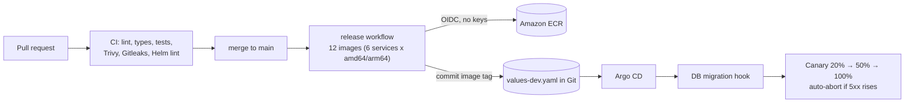

- **Infrastructure as code (Terraform):** VPC over 2 AZs with public, private and database
  subnets; EKS with access entries and the VPC CNI enforcing NetworkPolicies; RDS with TLS
  forced; SQS with a DLQ; ECR with immutable tags and scan-on-push; state in S3 with a KMS key
  and S3-native locking. [infra/terraform](infra/terraform)
- **No long-lived credentials anywhere:** GitHub Actions gets AWS access through OIDC, trusted only
  for this repo's `main` branch and pinned to GitHub's immutable repo and owner IDs. Pods use
  **EKS Pod Identity**, one IAM role per workload (the scout may only send to the queue, the
  scorer may only receive from it).
- **Secrets never touch Terraform state:** generated with ephemeral resources, written with
  write-only arguments to SSM, then synced into Kubernetes by External Secrets.
- **GitOps:** Argo CD app-of-apps with sync waves (CRDs → secrets → monitoring → app). The
  cluster is driven only from Git; manual changes are reverted.
- **Kubernetes hardening:** non-root, read-only root filesystems, no Linux capabilities,
  seccomp, PDBs, liveness ≠ readiness, default-deny NetworkPolicies.
- **SLOs as code:** 99.5% availability and p95 < 300 ms, recording rules, multi-window
  error-budget burn alerts, a runbook per alert ([docs/runbooks](docs/runbooks)).
- **DevSecOps:** Trivy on dependencies, images and IaC; Gitleaks; SBOMs; actions and base images
  pinned by SHA/digest; accepted risks documented with reasons and expiry dates
  ([.trivyignore.yaml](.trivyignore.yaml)).
- **Chaos scripts:** pod kill, fault injection, CPU stress, cutting DB egress, poison messages,
  each with the expected outcome written down ([scripts/chaos](scripts/chaos)).

---

## See it running

Deployed end to end on **AWS EKS (ap-south-1)** on 29 Oct 2026 from this repo. The
environment is torn down after each demo to keep costs near zero, so these screenshots are the proof.

**GitOps: Argo CD manages 12 apps (platform + app), all Synced and Healthy**

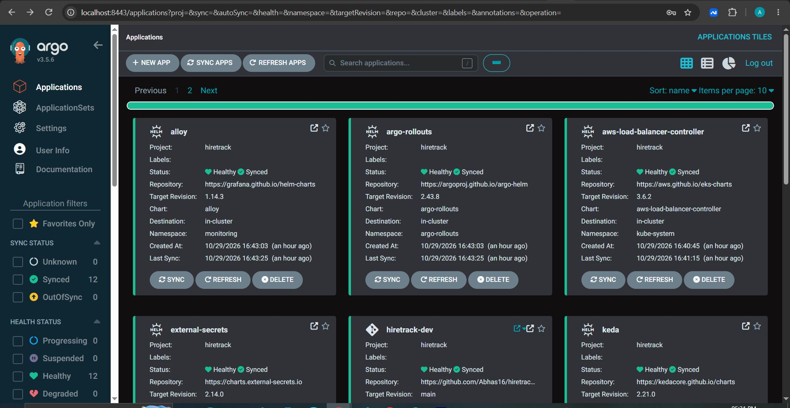

**The app's resource tree:** the API as an Argo Rollouts canary, HPA, CronJobs, and match-scorer
scaled by a KEDA ScaledObject. Here a job-scout run has just queued jobs, so KEDA is running 5
scorer pods. The sync bar shows the commit made by the release workflow's tag bump.

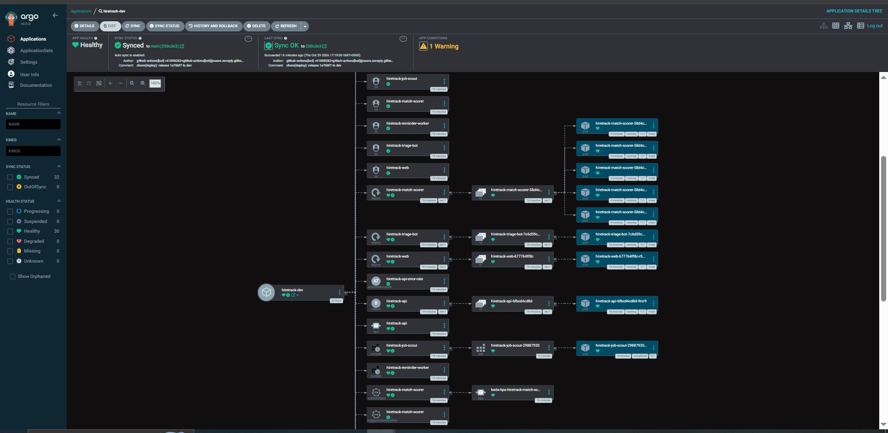

**SLO dashboard (Grafana):** request rate by status, error ratio against the 0.5% error budget,
and p95 latency against the 300 ms SLO, overall and per route.

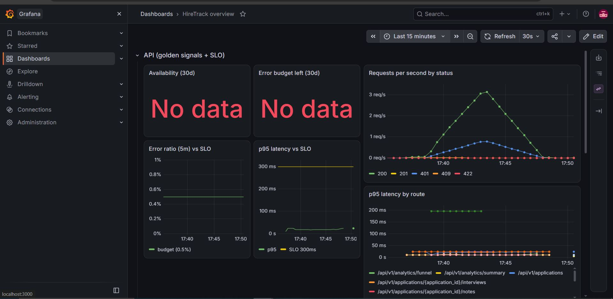

**Event-driven scaling:** a scout run found 137 new jobs on public Greenhouse / Lever / Ashby
boards, and KEDA scaled match-scorer **0 → 5 → 0** pods on SQS queue depth.

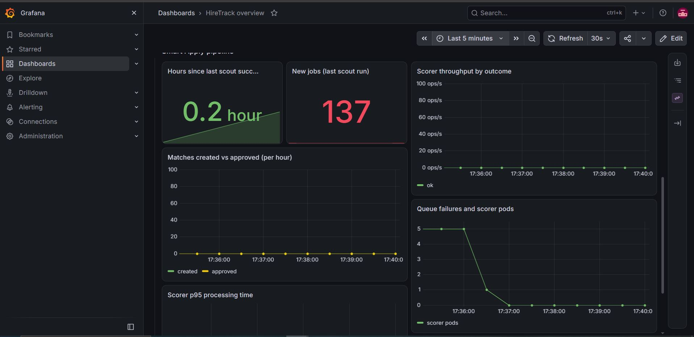

**Structured logs (Loki):** JSON logs with a request ID on every line, collected by Alloy.

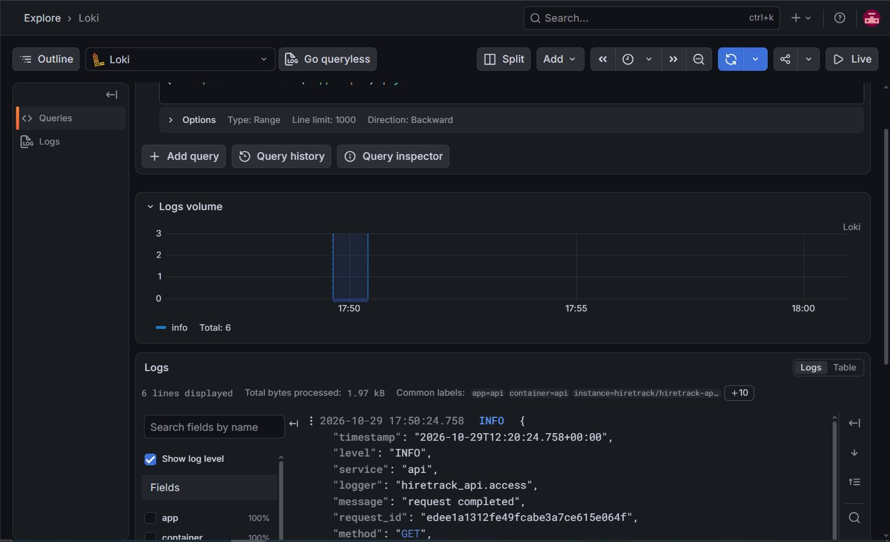

**Prometheus:** every ServiceMonitor target up, and the API request rate by status.

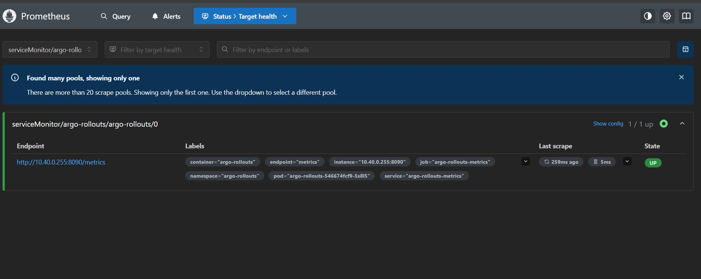
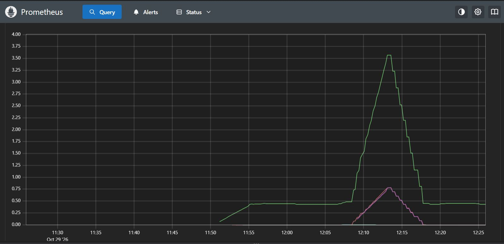

### Problems found and fixed during the real deployment

| Symptom | Root cause | Fix |
|---|---|---|
| CI could not log in to AWS | GitHub's OIDC subject now includes immutable IDs (`repo:owner@id/repo@id:...`) | Trust policy pinned to those IDs (found through CloudTrail) |
| Pods kept moving, links dropped | Spot capacity in ap-south-1 kept being reclaimed | Capacity type is a variable; demo ran on-demand |
| RDS create failed | `insufficient-capacity` for db.t4g.micro | Moved to db.t4g.small |
| Loki crash-looped | Chart mounts no data volume when persistence is off; root FS is read-only | emptyDir at `/var/loki` |
| GitOps sync stalled | Migration hook pulled an image tag that did not exist yet | Releases now push images before committing the tag |
| SLO panels said "No data" | With zero 5xx, `sum()` returns nothing instead of 0 | `or vector(0)` in rules and panels |
| Security gate failed | Trivy IaC findings | 2 fixed (KMS key, EKS API limited to one IP), 2 accepted with reasons + expiry |

---

## Tech stack

**Frontend:** React 18 · TypeScript · Vite · TanStack Query · React Router · Tailwind CSS ·
React Hook Form · Zod · dnd-kit · Recharts · Vitest · Testing Library · ESLint · Prettier

**Backend:** Python 3.12 · FastAPI · SQLAlchemy 2 · Alembic · Pydantic v2 · httpx · boto3 · uv
workspace · pytest · testcontainers · ruff · mypy

**Data and messaging:** PostgreSQL · Redis Streams (local) / Amazon SQS (cloud)

**Platform:** AWS (EKS, RDS, SQS, ECR, SSM, KMS, ALB, IAM) · Terraform · Docker · Helm · Argo CD ·
Argo Rollouts · KEDA · External Secrets · AWS Load Balancer Controller · GitHub Actions

**Observability:** Prometheus · Grafana · Loki · Alloy · Alertmanager · Pushgateway

---

## Run it locally

Needs Docker. Copy `.env.example` to `.env`, then set `DB_PASSWORD` and `JWT_SECRET` (32+ characters).

```bash
docker compose up --build            # postgres, redis, migrate, api, web, match-scorer, triage-bot
open http://localhost:8080           # web app    (API docs: http://localhost:8000/docs)

docker compose run --rm job-scout    # one scout run against the real public board APIs
uv run python scripts/seed-data.py --with-smart-apply   # demo data + review-queue matches
# log in as demo@hiretrack.dev / demo-password-123
```

Without containers: `make help` lists every target (`make test`, `make lint`, `make run-api`,
`make web-dev`, ...).

## Deploy to AWS

```bash
terraform -chdir=infra/terraform/bootstrap apply          # state bucket (once)
terraform -chdir=infra/terraform/envs/dev apply           # VPC, EKS, RDS, SQS, ECR, IAM (~20 min)
scripts/bootstrap-cluster.sh                              # kubeconfig, values, Argo CD
scripts/teardown.sh                                       # remove everything (ALB first)
```

Step by step, cost (about $7-10 per day while running) and design choices:
[infra/terraform/README.md](infra/terraform/README.md) and [deploy/README.md](deploy/README.md).

## Repository

```
services/
  web/               React + TypeScript app (features/, components/, lib/)
  api/               FastAPI: tracker, review queue, analytics, practice interviews
  job-scout/         public job-board fetcher (CronJob)
  match-scorer/      queue worker that scores jobs and writes the kit
  reminder-worker/   follow-up reminders (CronJob)
  triage-bot/        Alertmanager → GitHub issue incident bot
libs/hiretrack_common/   shared models, queue abstraction (Redis/SQS), logging, metrics
config/              sources.yaml (companies to scout), skills.yaml (skill taxonomy)
infra/terraform/     AWS infrastructure (bootstrap + envs/dev)
deploy/              helm/ (app chart, SLO rules, dashboard), argocd/, platform/ (add-ons)
.github/workflows/   api, web, helm, security, release
docs/                adr/ (design decisions), runbooks/, screenshots/, design/
scripts/             seed-data.py, chaos/, bootstrap-cluster.sh, teardown.sh
```

## Design decisions

Short write-ups of the main choices are in [docs/adr](docs/adr): the queue abstraction, the
human-in-the-loop Smart Apply, and "rules first, LLM optional".
